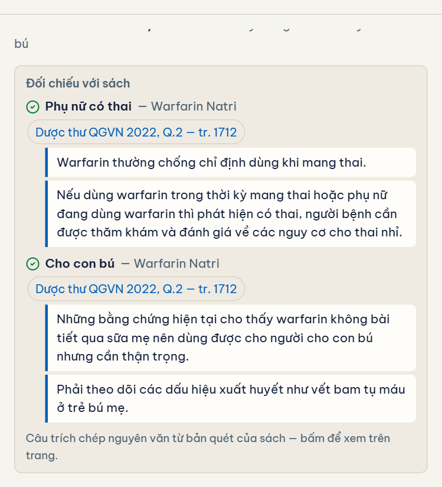
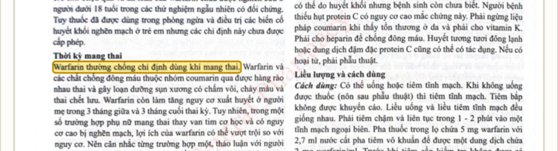
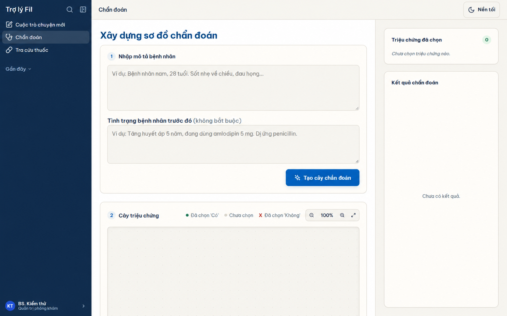

# Fil — a retrieval assistant over Vietnamese medical reference books

I built Fil for my father, a physician who still looks things up by hand in the
scanned Vietnamese reference books on his desk. It answers his questions from
those books, and every answer points to the exact page, with the passage
highlighted on the scan, so he can check it against the original.

> **Tóm tắt.** Trợ lý tra cứu y văn cho bác sĩ, chạy trên chính các cuốn sách
> scan (Dược thư Quốc gia 2022, sách thuốc biệt dược). Ba công cụ: hỏi đáp có
> trích dẫn trang, hỗ trợ chẩn đoán và danh mục tra cứu thuốc. Lõi truy xuất được thiết kế
> riêng cho cách bác sĩ Việt gõ và cho cấu trúc cố định của Dược thư.

| Evidence checklist for a two-condition question | The quoted sentence highlighted on the scanned page |
|---|---|
|  |  |



## What it does

| Feature | What the doctor sees |
|---|---|
| **Home** (`/`) | A public homepage with a drug search and links to each tool. |
| **Drug reference** (`/thuoc`) | Search by generic name or an available alias and filter by initial letter. Read stored monograph sections and open their cited scans. Lookup works without an AI key. |
| **Ask the books** (`/hoi-dap`) | A separate chat page with numbered citations. Clicking a citation opens the scanned page with the sentence highlighted. |
| **Diagnosis** (`/chan-doan`) | A symptom decision tree built from one patient description, including any history, current medication and allergies supplied by the doctor. |
| **Drug administration** (`/quan-tri`) | Administrators can validate and publish CSV or JSON records. The page provides both templates. |

The interface is deliberately plain: one font (Be Vietnam Pro), hospital blue,
large targets, and no usage instructions to read. My father is not comfortable
with technology, so every screen needed to be obvious on first use.

## Why not a generic RAG pipeline

Dense + sparse retrieval with a reranker works for any website. It fails on
this corpus for reasons specific to Vietnamese clinical reading, so the core of
the project is three pieces that only make sense here.

**1. Understanding how a Vietnamese doctor types** — `query_normalize.py`, `drug_alias.py`, `query_intent.py`
- Doctors type without diacritics or with leftover Telex keystrokes
  (`lieu dungf`). Fil repairs Telex and restores diacritics with a Viterbi
  search *constrained to word forms that actually occur in the books*, so it
  can never "correct" a word into something the library does not contain.
- Drug names come in Vietnamese–French transliteration (`amoxicilin`),
  international INN (`amoxicillin`), or brand names (`Efferalgan`). A folding
  key (`ph→f`, `th→t`, `y→i`, salt stripping…) plus an alias store built from
  the books' own metadata links all three to one monograph. Brand synonyms and
  abbreviations (ĐTĐ, THA, BPTNMT…) are only used once a source has confirmed them.

**2. Using the book's structure as the router** — `query_intent.py`, `query_plan.py`, `vector_store.py`
- Every monograph in the national formulary has the same fixed sections
  (Dosage, Contraindications, Pregnancy…). Eleven question intents map
  directly to those sections, and an extra rank-fusion channel retrieves from
  *the right drug ∩ the right section*.
- A question such as *"amoxicillin dose for a child with renal failure"* needs
  **two** pieces of evidence. Fil splits it deterministically (no LLM planner)
  into (drug, condition) pairs, searches for each one separately, and shows a
  checklist: ✓ found on page N with the verbatim sentence, ⚠ only mentioned in
  a secondary section, or ✗ **the library has no information**. The model is
  told the same checklist and must say what is missing instead of guessing.

**3. Numbers as anchors** — `answer_verify.py`, `page_locate.py`
- Every dose number in an answer must appear in the cited passage; ungrounded
  numbers are flagged.
- On scanned Vietnamese pages, digits survive OCR far better than diacritics.
  So the highlighter aligns the quoted sentence with the page's OCR words and
  prefers the match that contains the *same numbers*. A neighbouring sentence
  with the same words but a different dose is never highlighted by mistake.

## Measured results

Each change was measured on evaluation sets built from the books (`eval/`), and
changes were rolled back when the numbers showed they hurt.

| Measurement | Before | After |
|---|---|---|
| Right section of the right drug at rank 1 (270 questions) | 37.4% | **99.6%** |
| Same, rephrased questions (240) | 40.8% | **95.0%** |
| Brand-name queries, precision@5 | 50% | **100%** |
| Queries typed without diacritics, precision@5 (10 queries; held-out set: 24% → 86%) | 32% | **100%** |
| Queries typed with Telex leftovers, precision@5 (10 queries; held-out set: 20% → 96%) | 24% | **100%** |
| Two-condition questions with evidence for **both** conditions (55) | 90.9% | **100%** |
| Conditions reported "not in the library" that were actually present | — | **0 of 26** |
| Quoted sentence highlighted with all of its numbers on the scan (471) | 67.9% | 70.1% |
| Quoted sentence highlighted in the **wrong place** | 13.4% | **6.2%** |

Known limits: quotes are copied from OCR text and can contain OCR typos (which
is why every quote opens the page image); sentences that continue onto the
next page are not highlighted yet.

## Architecture

```
React 18 + Vite  ──SSE──►  FastAPI
                             ├─ query understanding (normalize · aliases · intents · plan)
                             ├─ retrieval: Chroma (multilingual-e5-small) + BM25 (pyvi)
                             │            + section-focus channel, fused with RRF
                             ├─ evidence checklist + verbatim quotes
                             ├─ LLM answer (DeepSeek) + numeric grounding check
                             └─ page images + OCR word boxes (PyMuPDF, Tesseract)
```

Storage is plain files: Chroma for the index, SQLite for accounts, library and
feedback. No external database is needed.

## Running it

Requirements for the website: Python 3 and Node.js. Configure a DeepSeek API key in
`.env` (`DEEPSEEK_API_KEY=...`) for AI answers and diagnosis. OCR workflows also
use Tesseract with the Vietnamese language pack.

```bash
python run.py        # installs dependencies, starts backend :8000 and frontend :3000
```

Then open http://127.0.0.1:3000. Operational details are in `RUNBOOK.md`;
deployment notes (frontend on Vercel, backend on a server with a persistent
disk) are in `DEPLOY_VERCEL.md`.

### Managing the drug directory

Sign in with an administrator account, open `/quan-tri`, and download a CSV or
JSON template. Upload a UTF-8 file to validate it, then publish it. Each record
needs a stable `id`, drug name, source title and at least one section. Reusing
an import ID replaces that entire imported record. The backend stores imports
in `backend/data/drug_catalog.db`.

When available locally, shared Dược thư Quốc gia Việt Nam 2022 chunks appear
alongside imported records and are labeled as OCR. Each scan link opens the
page cited for its section. Manually transcribed monographs in
`backend/data/verified_monographs/<doc_name>.json` take precedence over OCR
under the same catalog link. Keep these files with the locally licensed
corpus. Each manually transcribed section has text blocks and the original
printed and PDF page numbers.
A fresh checkout has no bundled monographs. Add the licensed local corpus or
import reviewed records. See the [redesign and retrieval research](docs/website-and-drug-directory-research.md).

```bash
python -m unittest discover -s tests     # backend tests
cd frontend && npx vitest run            # frontend tests
python eval/eval_phase3.py --persist-dir <copy of the index>
```

## Data and licensing

The scanned books are **not** in this repository: the national formulary is
licensed for internal use only. Only code, evaluation scripts and reviewed
lexicons are published. `backend/library_sources.py` lists freely usable
material for expanding the library: Ministry of Health treatment guidelines
(government documents, not covered by copyright under Vietnam's IP Law, Art. 15)
and WHO publications (CC BY-NC-SA 3.0 IGO).

Fil is a reference tool for a licensed physician, not a diagnostic device.

Code: MIT License.
